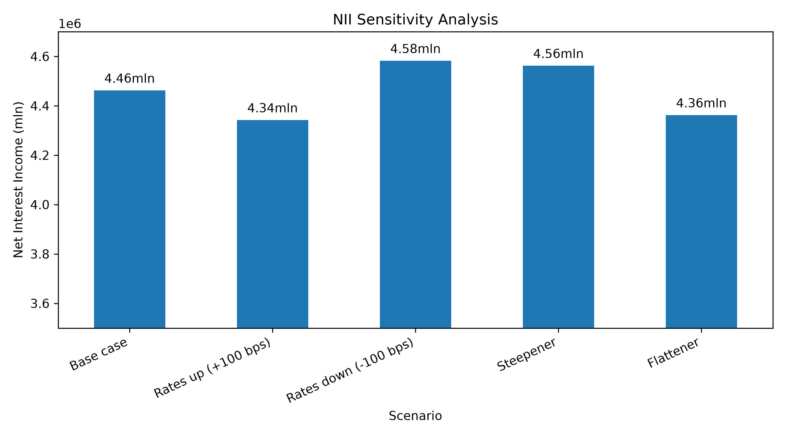
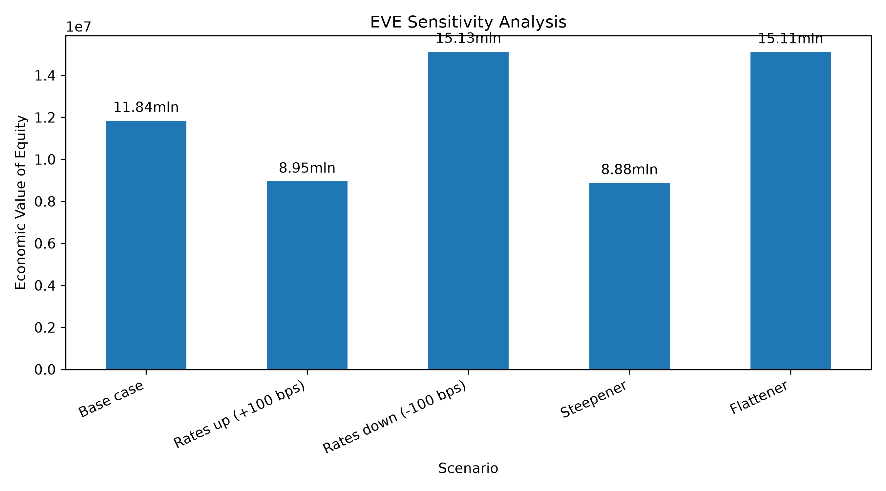
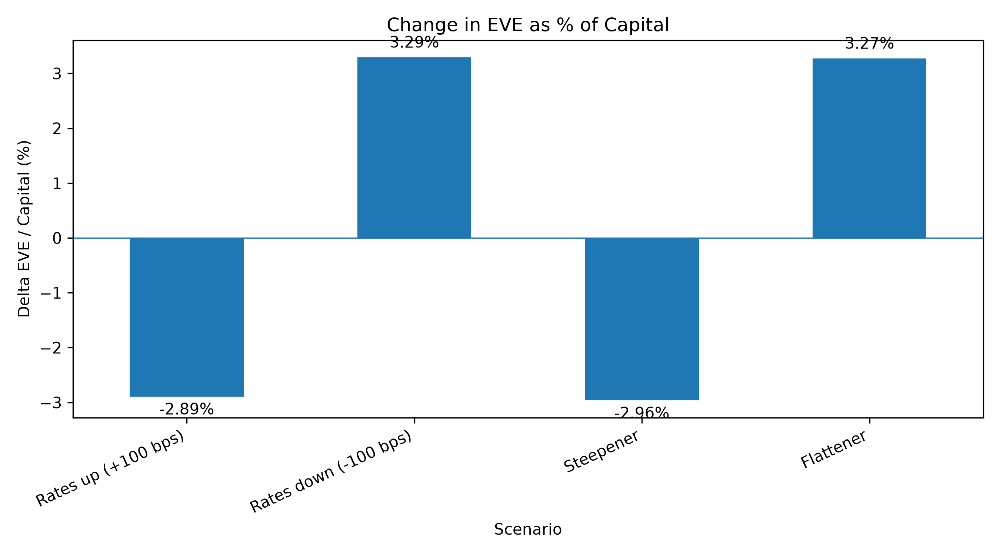

# IRRBB Analysis — NII & EVE Sensitivity

## Project Overview

This project focuses on the analysis of Interest Rate Risk in the Banking Book (IRRBB) using Python.

The objective is to assess how changes in interest rates affect a bank's Net Interest Income (NII) and Economic Value of Equity (EVE) under different interest rate scenarios.

The project uses synthetic banking data to demonstrate scenario analysis, interest rate sensitivity calculations and financial risk visualisation.

## Project Objectives

- Analyse NII sensitivity under different interest rate scenarios.
- Assess EVE sensitivity to parallel and non-parallel yield curve shifts.
- Evaluate changes in EVE relative to an assumed capital base.
- Compare the potential impact of different interest rate movements.
- Present the results through clear, reproducible Python visualisations.

## Methodology

Net Interest Income (NII)

NII analysis evaluates the impact of interest rate scenarios on modelled net interest income. The results illustrate how different interest rate movements can affect a bank's earnings.

Economic Value of Equity (EVE)

EVE analysis evaluates changes in the economic value of the banking book under parallel and non-parallel interest rate shocks.

EVE-to-Capital Ratio

The change in EVE is expressed relative to the assumed capital base:

ΔEVE / Capital (%)

This metric illustrates the potential significance of changes in economic value in relation to capital.

## Interest Rate Scenarios

The model for EVE includes five scenarios:

Scenario| Description
Base Case| Reference scenario without an interest rate shock
Rates Up (+225 bps)| Parallel upward shift in interest rates
Rates Down (-225 bps)| Parallel downward shift in interest rates
Steepener (-350 and -200 bps)| Short-term rates decrease while long-term rates increase
Flattener (350 and 200 bps)| Short-term rates increase while long-term rates decrease

The non-parallel scenarios apply different shocks to short- and long-term rates to illustrate changes in the shape of the yield curve.

## Results and Visualisations

### Net Interest Income (NII) Sensitivity

The chart compares modelled NII across the selected interest rate scenarios.

### Economic Value of Equity (EVE) Sensitivity

The chart illustrates the impact of different interest rate shocks on the modelled economic value of the banking book.

### Change in EVE Relative to Capital

This chart presents the change in EVE as a percentage of the assumed capital base, supporting a relative assessment of the modelled impact.

## Technology Stack

- Python — financial calculations and scenario modelling
- Pandas — data processing and analysis
- Matplotlib — data visualisation
- CSV — input data storage

## Project Structure

IRRBB-Analysis/
├── data/
│ ├── assets.csv
│ ├── liabilities.csv
│ ├── market_rates.csv
│ └── cash_flows.csv
├── charts/
│ ├── nii_sensitivity.png
│ ├── eve_sensitivity.png
│ └── delta_eve_capital.png
├── main.py
├── requirements.txt
└── README.md

## How to Run

Prerequisites

Python 3 and pip are required.

Installation

Install the required dependencies:

pip install -r requirements.txt

Execution

Run the analysis from the project directory:

python main.py

The script processes the input data, performs the scenario calculations and generates the analysis outputs and charts, provided the chart-saving code is included in "main.py".

## Key Takeaways

This project demonstrates how Python can be applied to banking risk management to:

- Assess interest rate sensitivity from both earnings and economic value perspectives.
- Compare the effects of parallel and non-parallel yield curve shifts.
- Express changes in EVE relative to a capital assumption.
- Translate financial risk calculations into visual outputs that support interpretation and communication.

## Disclaimer

This project uses synthetic data and simplified modelling assumptions for educational and portfolio demonstration purposes. It is not a complete regulatory IRRBB framework and should not be interpreted as an official bank risk assessment or a regulatory capital calculation.

## Author

An independent project demonstrating the application of Python to interest rate risk analysis and banking risk management.
